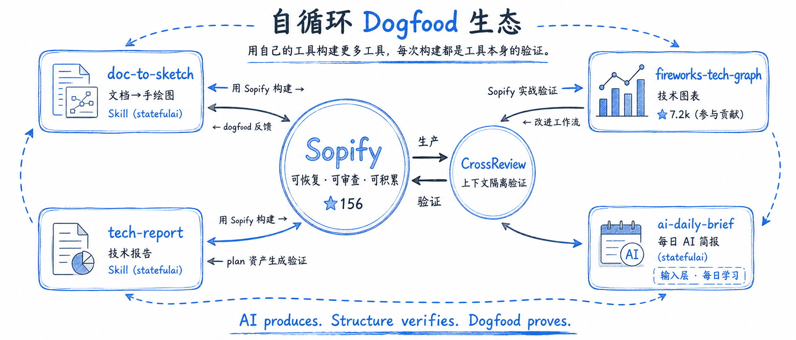

  English · <a href="README.md">简体中文</a>

  

---

## 🧭 What I'm Thinking About

We're in the golden age for learners — people with ideas can now collide with AI, validate fast, and iterate fast. But only if you can trust what it produces.

**AI is an effective producer, but not a reliable self-verifier.**

Models tend to agree with their own outputs, and shared context reinforces that agreement. You don't need a different model — just a different context. That's **CrossReview**'s core insight.

But local optimum ≠ global optimum: every diff passing review doesn't mean long-term plans are consistent; every task completing doesn't mean knowledge assets are trustworthy. **Sopify** makes the AI workflow itself recoverable, reviewable, and accumulable.

> **A structural engineer isn't someone who writes better prompts — it's someone who designs boundaries, contracts, state, and feedback loops.**

All tool projects are dogfooded within the Sopify workflow — **AI produces. Structure verifies. Dogfood proves.**

  

---

## 🔨 Core Projects

<table>
<tr>
<td width="50%" valign="top">

### [Sopify](https://github.com/evidentloop/Sopify)

Recoverable, reviewable, accumulable AI coding workflow

- 🔄 Resume from current state after interruption
- 📋 Plans, blueprints, history become reusable project assets
- ⏸️ Pauses when facts are missing, waits at decision points
- 🌐 Supports Claude / Codex / Trae CN multi-host
- 📍 **Position**: Global optimum — workflow-level structural governance

</td>
<td width="50%" valign="top">

### [CrossReview](https://github.com/evidentloop/cross-review)

Context-isolated cross-verification

- 🎯 **Core mechanism**: Input isolation, not model diversity
- 📦 `ReviewPack` → isolated review → structured findings
- 🔭 Not just code — applies to any reviewable artifact
- 🔌 Plugs into any AI coding workflow
- 📍 **Position**: Local optimum — independent verification per change

</td>
</tr>
</table>

---

## 🧰 AI Tool Ecosystem [@statefulai](https://github.com/statefulai)

All tools below are dogfooded within the Sopify workflow:

| Project | Description |
|---------|-------------|
| [doc-to-sketch](https://github.com/statefulai/doc-to-sketch) | Documents → hand-drawn style technical illustrations |
| [tech-report](https://github.com/statefulai/tech-report) | Code / commits / docs → structured technical reports |
| [ai-daily-brief](https://github.com/statefulai/ai-daily-brief) | Daily AI news auto-digest |

---

## 🛠 Tech Stack

        

---

  

