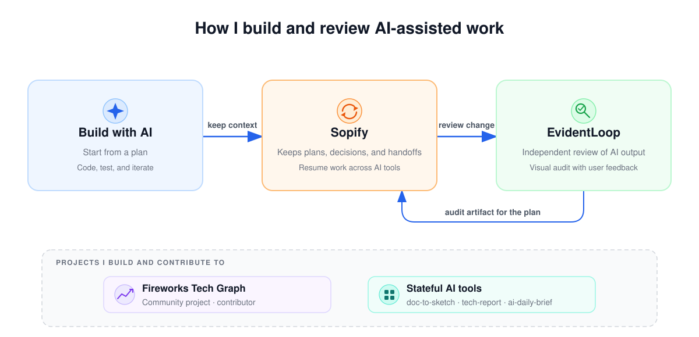

# Li-Sanze

简体中文 · [English](./README.en.md)

我在做 AI 协作开发工具，主要维护 [Sopify](https://github.com/evidentloop/sopify) 和 [EvidentLoop（dsh-evidentloop）](https://github.com/evidentloop/dsh-evidentloop)，也参与社区共建的 [Fireworks Tech Graph](https://github.com/yizhiyanhua-ai/fireworks-tech-graph)。

我主要关注三个具体问题：工作中断后怎么接着做，AI 产物怎么独立审查，审查证据怎么留在计划里。

## 主要维护

### [Sopify](https://github.com/evidentloop/sopify)

Sopify 是一套安装到现有 AI 编程工具中的工作流规则，不需要新的编辑器或独立应用。计划、决策、交接和验证记录留在仓库里，换一个 AI 工具或隔一段时间回来仍能继续。

### [EvidentLoop](https://github.com/evidentloop/dsh-evidentloop)

[DeepSeek Harness](https://github.com/deepseek-ai/deepseek-harness) 的 AI 代码变更评审插件（beta）：只读本地未提交或分支改动，整理成可验收的交付，按功能说明改动、逐条核对需求、给出带代码原文依据的问题，并写回会话草稿与留档导出。[官网介绍](https://evidentloop.sanze.dev) · [实录演示](https://evidentloop.sanze.dev/demo.html) · [npm (`@beta`)](https://www.npmjs.com/package/@evidentloop/dsh-evidentloop)

## 参与的社区项目

### [Fireworks Tech Graph](https://github.com/yizhiyanhua-ai/fireworks-tech-graph)

把自然语言转成可编辑的 SVG 和 PNG 技术图。上面的工作流图也用它完成。

## 其他项目

- [zh-tech-writing](https://github.com/statefulai/zh-tech-writing) — 审阅和修改简体中文技术文档，保留技术语义，并区分方案、实现和验证状态。
- [doc-to-sketch](https://github.com/statefulai/doc-to-sketch) — 把文档转成中文手绘技术配图。
- [reading-maps](https://github.com/Li-Sanze/reading-maps) — 先看全书结构，按问题深挖，最后回到原文。
